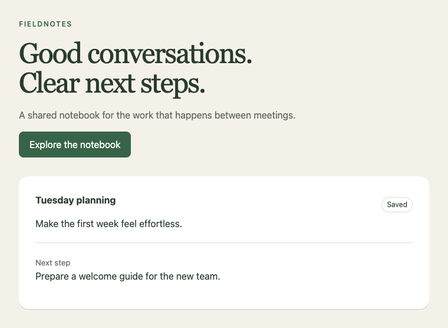
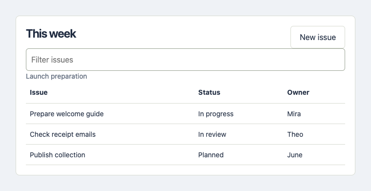
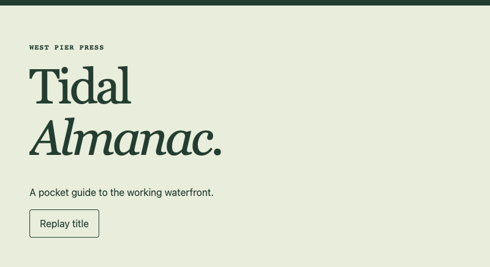

# Design Atlas MCP

Design Atlas is an open library of working interface studies for designers and coding agents. Search a reference, try the interaction, inspect its HTML and CSS, and turn it into a kit for your brand.

**[Try the guided demo](https://tradelord223.github.io/design-atlas-mcp/try.html) · [Browse 36 studies](https://tradelord223.github.io/design-atlas-mcp/) · [Open the brand studio](https://tradelord223.github.io/design-atlas-mcp/workbench.html) · [Get the MCP release](https://github.com/Tradelord223/design-atlas-mcp/releases/tag/v1.0.1)**

| A quiet product introduction | Working issue queue | An editorial motion study |
| --- | --- | --- |
| [](https://tradelord223.github.io/design-atlas-mcp/?id=calm-product-hero) | [](https://tradelord223.github.io/design-atlas-mcp/?id=issue-list) | [](https://tradelord223.github.io/design-atlas-mcp/?id=opening-imprint) |

## Use it today

| To try | Open | What you can do |
| --- | --- | --- |
| A before-and-after redesign | [STRATA comparison film](https://tradelord223.github.io/design-atlas-mcp/films/strata/) | See how an existing ChatGPT Site changes when its field readings, icons and interaction are adapted with the MCP. |
| A working product pattern | [Guided demo](https://tradelord223.github.io/design-atlas-mcp/try.html) | Choose a study, interact with it, inspect the source and adapt it to a brand. |
| A microinteraction | [Ferry ticket](https://tradelord223.github.io/design-atlas-mcp/?id=press-ticket) | Hold a berth, release it, then inspect the seven motion frames and the code behind the transition. |
| Your own visual identity | [Brand studio](https://tradelord223.github.io/design-atlas-mcp/workbench.html) | Paste existing HTML and CSS or enter a brief. Preview the kit, check color contrast and download the HTML, stylesheet and tokens. |

[Watch the 14-second recording](https://tradelord223.github.io/design-atlas-mcp/try/walkthrough.mp4) to see the reservation study before and after a brand change. [Download the Harbor Press starter kit](https://github.com/Tradelord223/design-atlas-mcp/releases/download/v1.0.1/harbor-press-kit.zip), unzip it, and open `index.html` to explore the generated site, design tokens and reusable components.

## Connect a coding agent

**Install the MCP once.** Download the release tarball into the current directory, then install that local file with Node.js 22.16 or newer. This works with npm 12’s default remote-package policy.

```sh
curl -fLO https://github.com/Tradelord223/design-atlas-mcp/releases/download/v1.0.1/design-atlas-mcp-1.0.1.tgz
npm install -g ./design-atlas-mcp-1.0.1.tgz
design-atlas-mcp info
```

You can also [download the package in your browser](https://github.com/Tradelord223/design-atlas-mcp/releases/download/v1.0.1/design-atlas-mcp-1.0.1.tgz). The release includes SHA256SUMS.

**In Codex**, register the installed executable and open a fresh chat.

```sh
codex mcp add design-atlas -- design-atlas-mcp
```

**In Claude Code**, register the same executable.

```sh
claude mcp add --transport stdio design-atlas -- design-atlas-mcp
```

**In Cursor or Claude Desktop**, add this entry to the client’s MCP configuration.

```json
{
  "mcpServers": {
    "design-atlas": {
      "command": "design-atlas-mcp",
      "args": []
    }
  }
}
```

For a GUI client with a restricted PATH, use `node` as the command and the absolute path to `design-atlas-mcp/src/cli.js` inside the directory printed by `npm root -g` as its only argument. The first installation downloads dependencies. All core MCP tools operate offline afterward.

## Try a design brief

> Harbor Press publishes pocket field guides for ferry riders. Our ink color is #345d4e. Find two relevant editorial references and show me what each contributes. Build a responsive sample using our name, color and audience. Give me the tokens and HTML, and flag anything that still needs editorial or accessibility review.

For an existing product, paste its HTML and CSS into the workbench or use `import_brand_identity`. Review the identified colors, type, corner radii and the declarations they came from. Give the agent a specific component and its source. Ask it to preserve the brand typography and the component’s important states, compare two Atlas treatments, and apply the selected change. A screenshot or source link accompanies each study. Atlas previews show original implementations. A source link identifies the product or design-system example behind the study.

## Included in v1.0.1

- **36 studies** covering landing pages, notes, command menus, issue triage, forms, commerce, editorial layouts, financial dashboards, mobile onboarding, studios and motion. Each includes source attribution, an implementation and a versioned evidence bundle.
- **Nine design packs** with design decisions and tokens. Choose Quiet Product, Precise Workspace, Public Service, Material Commerce, Editorial Reference, Financial Clarity, Daily Companion, Independent Studio or Motion Printshop. The gallery shows the studies in each direction.
- **Eight product flows** with ordered steps, a pattern for each step, its goal and a failure or recovery consideration.
- **4,805 offline SVGs** across Lucide (2,403), Bootstrap Icons (2,078) and Heroicons 24px outline (324). Search by name and get an actual SVG with its license.
- **A brand workbench and source audit.** Generate responsive HTML, CSS, tokens and reusable components. Review copy, labels, document semantics, keyboard focus and motion rules. Palette checks report measured ratios. Static audits identify what still needs a rendered review.
- **Remix tools.** Export a complete specimen, isolate a named element, preview three changes side by side, or assemble selected sections and attribute each choice. A portable headline entrance can be attached to the first section in a composition.

## MCP tools

| Task | Tools | What your agent receives |
| --- | --- | --- |
| Search and inspect | `search_inspirations`, `get_inspiration` | Ranked candidates, stable IDs and source links. Inspection returns an inline PNG or seven ordered motion frames, plus a versioned manifest. |
| Read evidence | `read_inspiration_bundle`, `read_inspiration_source` | Bounded UTF-8 file transfers with SHA-256 verification, or numbered source lines with character continuation. |
| Use the Vault | `search_vault`, `get_vault_resource` | Implementation prompt and working source, documentation or extras drawn from the same Atlas studies. |
| Explore systems | `list_design_packs`, `get_design_pack`, `list_flows`, `get_flow` | Pack tokens, design principles, linked specimens and complete product journeys. |
| Use icons | `list_icon_packs`, `search_icons`, `get_icon` | Installed families, paginated names, copyable SVG and attribution. |
| Design for a brand | `import_brand_identity`, `create_brand_kit`, `audit_design` | Evidence from supplied brand markup and CSS, brand-specific output, and issues with concrete fixes. |
| Adapt a reference | `remix_inspirations` | A standalone rebuild, isolated detail, variations or composition proof from selected references. |
| Open a source library | `get_reference_guide` | Official links and client instructions for Details, Mobbin, Granola, Linear and six other design sources. A pasted Details link receives the matching official tool handoff. |

The server also exposes `atlas://library/index` as an MCP resource and `design_from_brief` as a reusable prompt.

### Search and inspect

1. Send the user's words as `query` with `projectContext`. Optionally pass `projectBrief`, `category`, `platform` or `packId`. Search uses local lexical and synonym ranking. Each gallery contains at most ten candidates.
2. Present the candidate links. To see another set or refine the terms, carry over `nextSearchArguments`, including its cumulative `excludeIds`.
3. Use `get_inspiration` with the selected Atlas ID or gallery URL. Its default response contains the visual evidence. Set `includeImages: false` for the metadata alone.
4. Read `instructions.md` before the files it cites. Supply the returned `version` on every subsequent read. For numbered source, follow `nextOffset` in the same line range before advancing to `nextStartLine`. Transfer mode uses byte offsets and base64 chunks. Text mode counts Unicode code points.
5. Use `get_vault_resource` for the code or `remix_inspirations` for a reviewable adaptation. Interactive demos identify their integration points for real data and service calls.

## Run from source

```sh
git clone https://github.com/Tradelord223/design-atlas-mcp
cd design-atlas-mcp
npm ci
node src/cli.js info
node src/cli.js kit examples/harbor-press.json ./harbor-kit
```

Open `harbor-kit/index.html` for the brand preview. The new directory also contains `brand.css`, `tokens.json`, individual components and `design-notes.json`. The exporter requires a fresh output directory.

```sh
npm start                         # MCP over stdio
node src/cli.js http --port 8787  # Streamable HTTP at http://127.0.0.1:8787/mcp
npm test                         # protocol, evidence, search, brand, icon and browser tests
npm run gallery                  # static site in dist/site
```

Browser checks use installed Chrome on macOS or `CHROME_PATH` elsewhere. The GitHub workflow supplies Chrome and verifies the browser tests before deploying Pages. To regenerate a specimen’s visual evidence, run `CHROME_PATH=/path/to/chrome npm run render -- opening-imprint`. With no IDs, the renderer captures the entire authored library.

For shared HTTP hosting, put the Node service behind HTTPS, set `ATLAS_HOST=0.0.0.0` and set `ATLAS_PUBLIC_ORIGIN` to the external origin. The HTTP server checks Host and Origin, accepts requests at `/mcp`, and holds no accounts or user content. A private deployment can enforce its own access controls at the reverse proxy. GitHub Pages serves the static gallery and workbench. A Gradio deployment adapter hosts the complete MCP at `/mcp` and adds optional screenshot similarity search on ZeroGPU. [Hugging Face deployment files](deploy/huggingface/README.md)

## Add your own design packs

From a checkout, run `npm run add-pack -- /path/to/pack.json`. The importer checks the pack’s IDs, rights declarations, references and schema before updating the local catalog. Render the new studies, then rebuild the gallery. The same studies become available to MCP search, inspection, the Vault and the brand workbench. [Pack authoring guide and example](docs/authoring.md)

## Provenance and licensing

The six core tool names and design workflows were independently reconstructed from Details’ public MCP guide, public client artifacts and unauthenticated protocol discovery. The repository contains the observed evidence, hashes and limits of that comparison. Details’ authenticated schemas, private ranking, captures and Vault corpus are outside the verified comparison. Mobbin and Details users with access to their hosted collections can open their official connectors through `get_reference_guide`. [Reconstruction record](docs/reconstruction.md) · [Details MCP](https://www.details.so/mcp.md) · [Mobbin MCP](https://mobbin.com/mcp)

Original implementation, studies and previews are MIT licensed. Icons retain their upstream licenses and attribution. Product names and linked design references belong to their respective owners. [Atlas license](LICENSE) · [Lucide](assets/icons/lucide/LICENSE) · [Bootstrap Icons](assets/icons/bootstrap/LICENSE) · [Heroicons](assets/icons/heroicons/LICENSE)
